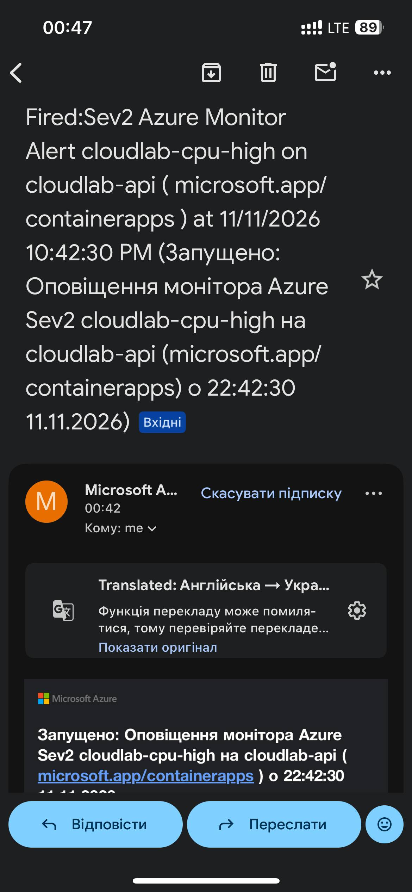
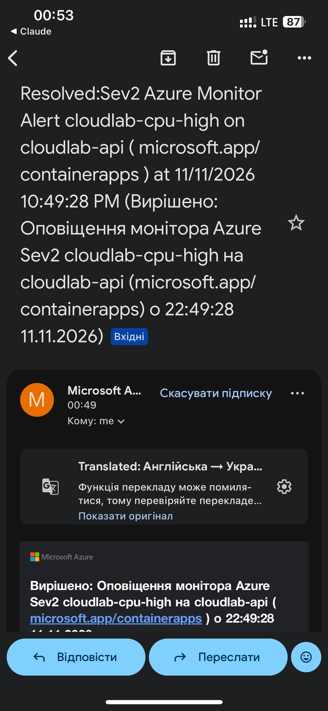

# Алерти

## Що налаштовано (Terraform, файл `infra/alerts.tf`)
- Група сповіщень `cloudlab-alerts`: надсилає email на пошту власника
  (адреса береться зі змінної `alert_email`, у репозиторії її немає).
- Алерт `cloudlab-cpu-high`: середнє використання CPU застосунком
  (метрика `UsageNanoCores`) більше 100 000 000 нано-ядер. Ліміт контейнера
  0,25 ядра = 250 млн, тож поріг це 40% від ліміту. Метрика усереднюється
  за вікно 5 хвилин, перевірка щохвилини, важливість Sev2.
- Налаштовано автоматичне закриття (`auto_mitigate`): коли CPU повертається
  до норми, Azure надсилає другий лист про те, що проблема зникла.

## Чому така умова
- CPU прямо відображає навантаження, і на нього ж спрацьовує автомасштабування,
  тому за алертом можна одразу порівняти, що робить система.
- Спочатку поріг був 70% (175 млн). Під час навантажувального тесту середній
  CPU тримався на рівні 110-150 млн (45-60%), бо після додавання другого
  екземпляра навантаження ділиться між ними. Тому алерт на 70% не спрацював,
  і ми знизили поріг до 40%. Тепер це раннє попередження: сервіс довго
  працює під помітним навантаженням.
- Вікно 5 хвилин потрібне, щоб одна короткочасна хвилина піку не давала
  хибної тривоги.

## Скріншоти листів
Лист «Fired» (алерт спрацював, 00:42):

Лист про відновлення (00:49):

## Час до першого листа
Навантажувальний тест стартував о 00:35, алерт спрацював о 00:42:30,
тобто до першого листа пройшло приблизно 7 хвилин. Затримка складається
з кількох частин: метрики Azure Monitor надходять із затримкою 1-3 хв,
потім алерт усереднює дані за 5 хв, і ще потрібен час на доставку листа.
Лист про відновлення прийшов о 00:49:28, тобто приблизно через 5 хв після
завершення тесту (тест закінчився близько 00:44:30).

## Оцінка
Алерт працює і спрацьовує тоді, коли треба, але він не швидкий:
7 хвилин від початку навантаження до листа. Для сервісу, який потребує
швидкої реакції, цього забагато. Слабкі місця: алерт бачить лише CPU і не
знає про помилки 5xx та затримки; через автомасштабування CPU сам знижується,
тому тривала проблема може «сховатись». Для реального сервісу додав би ще
алерти на частку 5xx і на p95 затримки, а також алерт «досягнуто максимум
екземплярів».